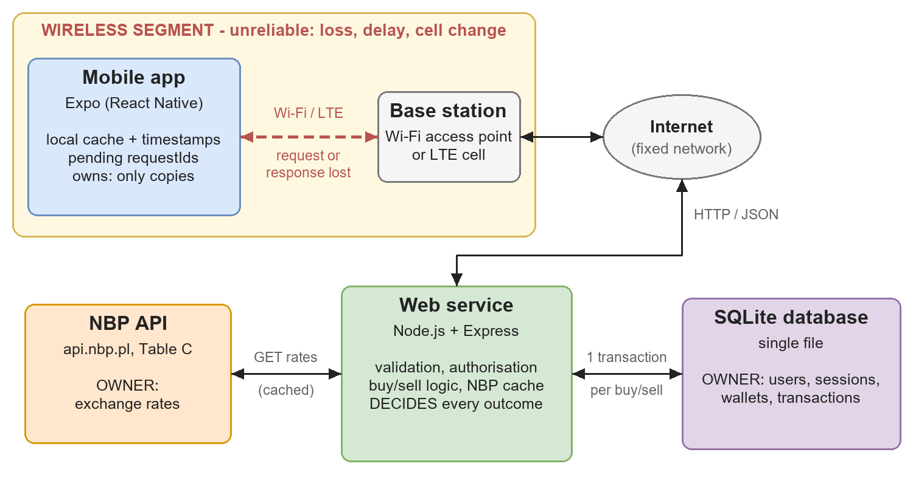
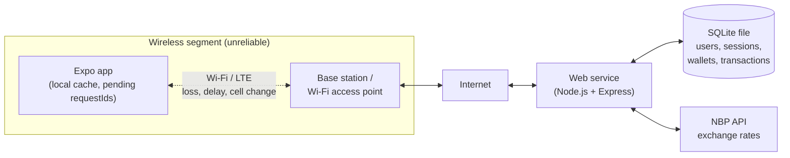

# Architecture

## Components

| Component | Technology | Responsibility |
|---|---|---|
| **Mobile app** | Expo (React Native), JavaScript | Shows rates, wallet and history; sends buy/sell/funding requests; keeps a local cache with timestamps and a list of pending `requestId`s |
| **Web service** | Node.js + Express, JavaScript | Validates and authorises every request, executes buy/sell inside a database transaction, fetches and caches NBP rates, records the authoritative outcome |
| **Database** | SQLite file (`better-sqlite3`) | Users, sessions, wallet balances, transactions |
| **External data source** | National Bank of Poland API (Table C) | Official bid/ask exchange rates |

Why this is the simplest workable stack for a small team: one language
(JavaScript) everywhere, the app runs on the phone through Expo Go without
Android Studio, and the database is a single file so any member can start the
service with `npm run dev` and reproduce every network-failure test.

## End-to-end sketch



Editable version: [diagrams/architecture.drawio](diagrams/architecture.drawio)



Only the segment between the phone and the base station is wireless. It is the
most likely place for delay, loss or disconnection, and a message can be lost in
**either** direction: the request may never reach the service, or the service may
finish and the response may never reach the phone.

## Data owners

| Data | Owner (source of truth) | Copies |
|---|---|---|
| Users, password hashes, sessions | Database | Mobile keeps only its session token |
| Wallet balances | Database | Mobile keeps a cached, read-only copy with a timestamp |
| Transactions | Database | Mobile keeps a cached copy of the history |
| Exchange rates | NBP API | Service caches the latest table with its fetch time; mobile caches the last rates shown |
| Pending request IDs | Mobile app | Database stores the ID with each transaction (`UNIQUE`), which is how duplicates are detected |

Rule: **the mobile app never decides an outcome.** Only the web service decides
whether a buy/sell succeeded, and only the database holds the result. The mobile
app never calls NBP directly; the service does (lecture Week 06: the service
shields the mobile client from the external data source).

## External data source: NBP API

- Base URL: `https://api.nbp.pl/api/`
- Current bid/ask for one currency (Table C):
  `GET /exchangerates/rates/C/USD/?format=json`
- Historical bid/ask for a date range:
  `GET /exchangerates/rates/C/USD/{startDate}/{endDate}/?format=json`
- No API key. Rates are published on business days only, so on weekends and
  holidays the latest table can be several days old; its `effectiveDate` is shown.

## Request path: "Buy 100 USD"

```mermaid
sequenceDiagram
    participant M as Expo app
    participant W as Wireless + base station
    participant S as Web service
    participant D as SQLite
    participant N as NBP API

    M->>M: create requestId, store as pending
    M->>W: POST /transactions/buy {requestId, USD, 100}
    Note over M,W: wireless segment - request can be lost
    W->>S: forward over the Internet
    S->>S: check session token, validate amount
    S->>D: is requestId already stored? (if yes: return the stored result)
    S->>N: current ask rate (or fresh cached table)
    S->>D: BEGIN; debit PLN; credit USD; insert transaction(requestId); COMMIT
    S-->>W: 201 Created {transaction, new balances}
    Note over W,M: wireless segment - response can be lost
    W-->>M: response
    M->>M: update wallet, remove requestId from pending
```

| Step | Where | What can go wrong |
|---|---|---|
| 1. User taps Buy; app creates `requestId` and marks it pending | Phone | - |
| 2. Request travels over Wi-Fi/LTE to the base station | **Wireless** | Request lost → service never sees it |
| 3. Request reaches the service over the Internet | Fixed network | Delay |
| 4. Service checks the session token and the amount | Service | Expired token, invalid amount |
| 5. Service checks whether `requestId` was already processed | Service to DB | - (this is what makes a repeat safe) |
| 6. Service takes the current ask rate | Service to NBP | NBP unavailable → cached table only if fresh enough |
| 7. One SQLite transaction: debit PLN, credit USD, insert transaction row | Database | Insufficient balance → rejected; two requests on the same wallet are serialised |
| 8. Response travels back to the base station | Fixed network | Delay |
| 9. Response travels to the phone | **Wireless** | **Response lost → outcome uncertain** for the user |
| 10. App updates the UI and clears the pending `requestId` | Phone | User may have moved, closed the app, or tapped again |

Steps 2 and 9 are the two different failures the course insists on separating:
"server never received the request" versus "server committed but the response was
lost". After a timeout the app cannot tell which one happened, so it asks
`GET /transactions/{requestId}` instead of sending the purchase again.
